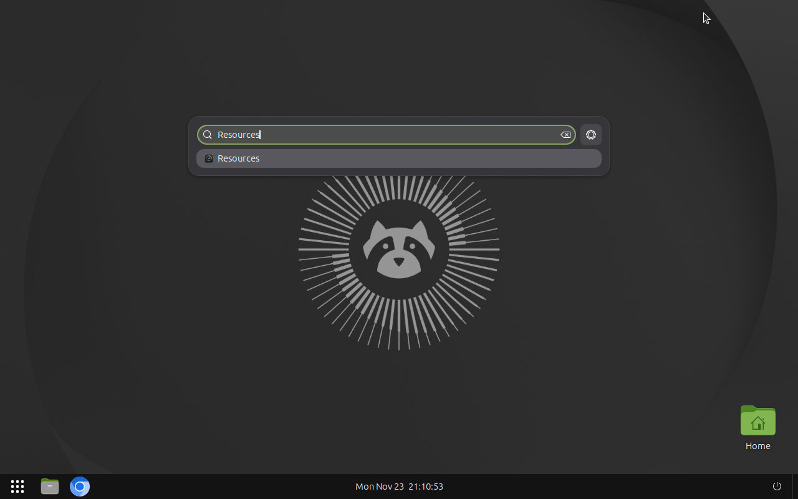
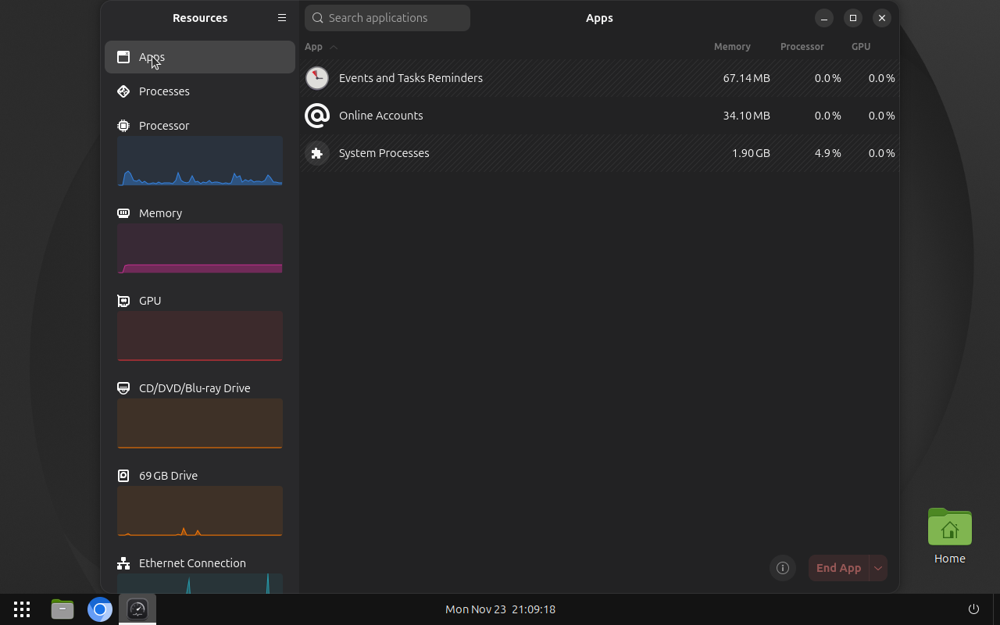

# UbuntuBaseSetup

Set up an Ubuntu GNOME desktop with a bottom taskbar, searchable app menu, window snapping, and a hardware monitor.

## Quick start

From a checkout on Ubuntu Desktop with GNOME Shell 50, open a terminal in your graphical session and choose one command.

| Desktop behavior | Command |
| --- | --- |
| Blank the screen after 15 minutes | `./setup` |
| Also lock when the screen blanks | `./setup --lock-after-15-minutes` |

Run the installer as your desktop user. It requests administrator approval for system changes. The first run downloads packages and builds Resources. Sign out and back in to load the desktop extensions.

## Using the desktop

- Press **Super** to search, **Super + Arrow** to snap a window, or **Ctrl + Shift + Esc** to open Resources.
- Open Files or Chromium from the taskbar. Press **Print Screen** to capture a selected area.
- Setup installs PyCharm Community, KeePassXC, Keeper, and, on amd64, ChatGPT Desktop. Keeper’s local MCP connection is configured during setup. Open Keeper to add your vault and manage access.

See the [setup guide](docs/setup.md) for the full app list, shortcuts, Keeper details, and troubleshooting.
